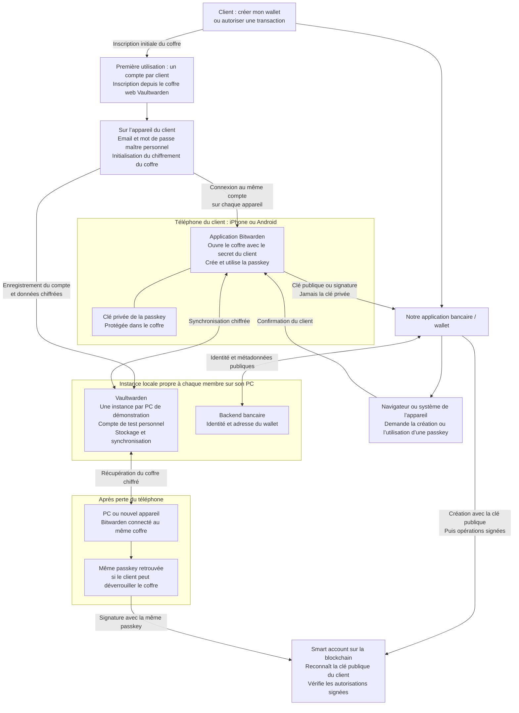

# Comptes, passkeys et reprise d’accès

Chaque membre lance sa propre instance Vaultwarden sur son PC et crée son compte de test personnel. Il n’est pas nécessaire de créer quatre comptes sur chaque instance. Les instances ne synchronisent pas leurs données entre elles. Dans une future banque, un serveur pourrait héberger plusieurs comptes clients séparés. Un client se connecte au même compte depuis plusieurs appareils. La première inscription se fait depuis le coffre web Vaultwarden ; le client choisit son propre mot de passe maître. La connexion bancaire ne crée pas automatiquement le compte de coffre dans ce POC.

Les échanges WebAuthn, la synchronisation des passkeys et la reprise du smart account représentent le parcours cible, encore à tester. Le serveur local et HTTPS Windows ont été vérifiés ; le téléchargement du certificat sur iPhone a été confirmé. L’application bancaire ne remplace pas automatiquement le fournisseur Bitwarden. Le serveur ne doit pas recevoir les secrets de déchiffrement du client. La perte totale des passkeys et des moyens d’ouvrir le coffre n’est pas résolue.

Voir [le guide de lancement](../README.md) et [le wiki du POC](https://wiki.dotshark.dev/doc/passkeys-poc-vaultwarden-bancaire-schema-et-etat-des-essais-ZKwEUZioKR).

Pour accéder à son instance, le téléphone et le PC doivent pouvoir communiquer sur le réseau choisi. Un free-wifi public/invité peut isoler les appareils ; l’accès local et la confiance HTTPS doivent être testés séparément. Chaque téléphone installe le certificat de son propre PC. Sur PC, installer et configurer l’extension Bitwarden dans le navigateur de la démo, même si l’installation est proposée automatiquement. Le [guide](../README.md) couvre iPhone et Android.
