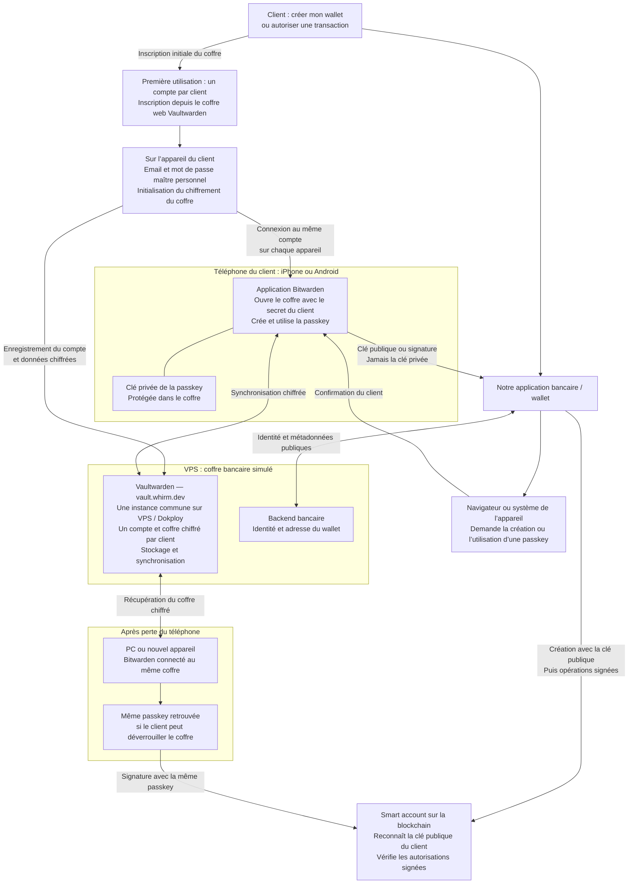

# Comptes, passkeys et reprise d’accès

Le POC utilise une instance commune sur VPS à **https://vault.whirm.dev**, gérée par Dokploy. Chaque client crée son compte personnel depuis le coffre web, choisit son mot de passe maître et utilise le même compte sur ses appareils. La connexion bancaire ne crée pas automatiquement le compte de coffre.

Les échanges WebAuthn, la synchronisation des passkeys et la reprise du smart account représentent le parcours cible, encore à tester. La configuration Compose VPS est validée ; DNS, déploiement HTTPS et clients restent à vérifier. Le proxy Dokploy fournit HTTPS avec un certificat public valide.

Le serveur Vaultwarden est hébergé sur le VPS ; le backend bancaire est représenté pour expliquer son rôle, et son hébergement n’est pas défini par ce dépôt. L’application bancaire ne remplace pas le fournisseur Bitwarden. Notre API ne reçoit ni mot de passe maître ni clé privée. La perte totale des passkeys et des moyens d’ouvrir le coffre n’est pas résolue.

Le PC et le téléphone peuvent utiliser des réseaux différents avec accès Internet au VPS. Sur PC, installer l’extension Bitwarden même si son installation est proposée automatiquement. Sur téléphone, installer Bitwarden Password Manager et choisir le serveur https://vault.whirm.dev. Un certificat HTTPS public valide ne nécessite aucun profil à installer.

Le domaine du coffre ne définit pas automatiquement l’origine/RP ID du frontend wallet. Voir [le guide](../README.md), le [déploiement Dokploy](dokploy.md) et [le wiki du POC](https://wiki.dotshark.dev/doc/passkeys-poc-vaultwarden-bancaire-schema-et-etat-des-essais-ZKwEUZioKR).
